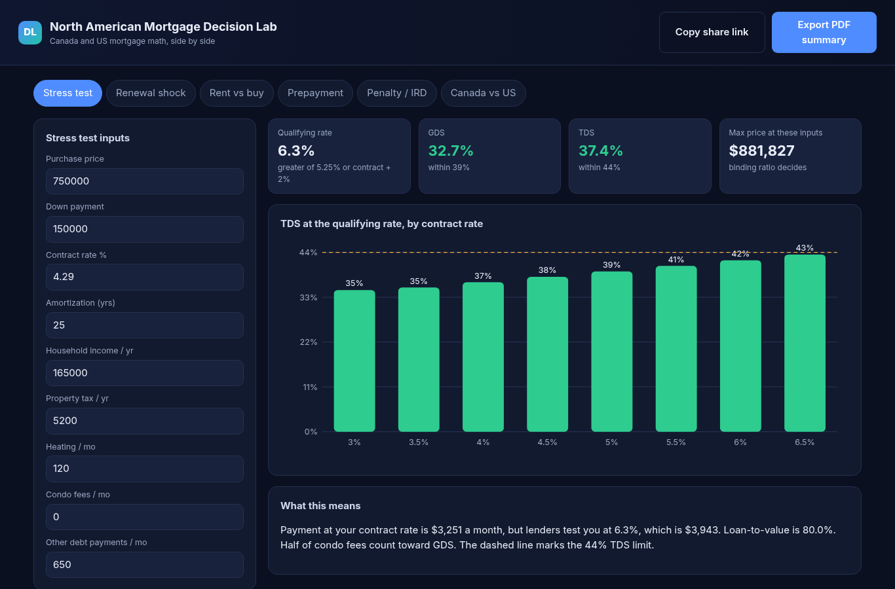
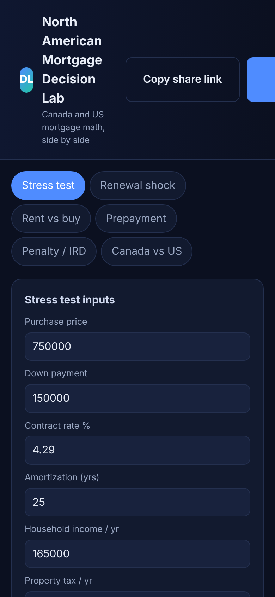

# Mortgage Decision Lab

**Live:** https://alenzacodes.github.io/mortgage-decision-lab/

The questions people actually ask before buying, answered on one page: will I pass the stress test, what happens at renewal, rent or buy, is prepaying worth it, and what does it cost to break the mortgage. It also puts a Canadian mortgage beside a US 30-year fixed, since the two are often compared and work very differently.

## The calculators

1. Stress test: GDS and TDS at the qualifying rate, the highest price that passes, and how TDS moves as rates change
2. Renewal shock: the payment change at a new rate
3. Rent vs buy: net worth from buying vs. renting and investing the difference
4. Prepayment: regular payments vs. adding prepayments
5. Penalty / IRD: three months' interest vs. interest rate differential, by months left in the term
6. Canada vs US: the same loan under semi-annual Canadian compounding and a US 30-year fixed

Results can be shared as a link or exported as a PDF summary.

## Running it

Open `index.html` or serve the folder with `python3 -m http.server 8000` and open http://localhost:8000/.

## Tests

    node tests/test.js

22 checks, including known payments ($500,000 at 5% over 25 years in Canada is $2,908.02/month; $400,000 at 6.5% over 30 years in the US is $2,528.27), schedules that end at zero, and the max purchase landing exactly on the binding GDS or TDS limit. They run on every push.

## Sources

- Interest Act, semi-annual compounding: https://laws-lois.justice.gc.ca/eng/acts/i-15/page-1.html
- OSFI minimum qualifying rate: https://www.osfi-bsif.gc.ca/en/supervision/financial-institutions/banks/minimum-qualifying-rate-uninsured-mortgages
- CMHC premiums and GDS/TDS limits: https://www.cmhc-schl.gc.ca/professionals/project-funding-and-mortgage-financing/mortgage-loan-insurance/mortgage-loan-insurance-homeownership-programs/premium-information-for-homeowner-and-small-rental-loans
- FCAC prepayment penalties: https://www.canada.ca/en/financial-consumer-agency/services/mortgages/reduce-prepayment-penalties.html
- Bank of Canada renewal analysis: https://www.bankofcanada.ca/2025/07/staff-analytical-note-2025-21/

US figures use a 30-year fixed with monthly compounding and are for comparison only.

On a phone:

Educational only, not financial advice.

## Licence

MIT. Copyright 2026 John Khan.
